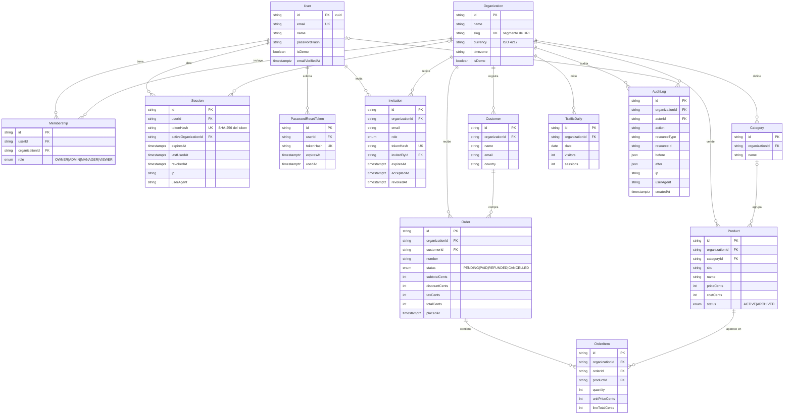

# Arquitectura — Vortex Metrics

Documento vivo. Describe las decisiones estructurales del proyecto tal como están
implementadas en el repositorio, y marca explícitamente lo que todavía pertenece a fases
posteriores.

---

## 1. Principios

1. **El tenant nunca lo elige el cliente.** El identificador de organización viaja en la URL
   (`/app/[orgSlug]`) y se resuelve contra una membresía verificada en el servidor.
2. **La autorización se comprueba dos veces.** En la capa de aplicación (guards + matriz de
   permisos) y en la base de datos (Row-Level Security con `FORCE`, Fase 9).
3. **Un fallo de aislamiento debe fallar cerrado.** Si una consulta olvida el filtro de tenant,
   no debe devolver filas de otra organización: RLS devuelve cero filas.
4. **Los números salen de SQL.** KPIs, gráficos y exports comparten las mismas definiciones y
   las mismas consultas parametrizadas. No hay datos mock alimentando el producto.
5. **El dinero es entero.** Todos los importes se guardan en centavos (`*_cents`); el formateo
   ocurre en el borde de la UI.
6. **Todo lo importante deja rastro.** Las mutaciones relevantes escriben en `audit_logs` con
   `before`/`after` a nivel de campo.

---

## 2. Vista de capas

```
┌──────────────────────────────────────────────────────────────────┐
│ UI — React Server Components + islas cliente                     │
│  · Sin reglas de negocio en componentes                          │
│  · TanStack Query para tablas interactivas                       │
│  · Skeletons, estados vacíos y de error explícitos               │
└───────────────────────────────┬──────────────────────────────────┘
                                │
┌───────────────────────────────▼──────────────────────────────────┐
│ Borde HTTP — Server Actions (escrituras) / Route Handlers (lecturas, exports)
│  · Zod: validación de entrada                                    │
│  · Rate limiting respaldado por Postgres                         │
└───────────────────────────────┬──────────────────────────────────┘
                                │
┌───────────────────────────────▼──────────────────────────────────┐
│ Autorización                                                     │
│  · Sesión opaca hasheada → usuario                              │
│  · orgSlug + sesión → Membership → rol                          │
│  · Matriz de permisos (OWNER / ADMIN / MANAGER / VIEWER)         │
└───────────────────────────────┬──────────────────────────────────┘
                                │
┌───────────────────────────────▼──────────────────────────────────┐
│ Acceso a datos                                                   │
│  · Repositorios con `organizationId` como primer argumento       │
│  · SQL parametrizado para analítica                              │
│  · Transacciones para mutaciones multi-tabla                     │
└───────────────────────────────┬──────────────────────────────────┘
                                │
┌───────────────────────────────▼──────────────────────────────────┐
│ PostgreSQL 16                                                    │
│  · Índices compuestos que empiezan por organization_id           │
│  · pg_trgm + GIN para búsqueda ILIKE '%texto%'                   │
│  · RLS con FORCE + políticas por tenant (Fase 9)                 │
└──────────────────────────────────────────────────────────────────┘
```

---

## 3. Modelo de datos

14 tablas de aplicación. El esquema completo y comentado vive en
[`prisma/schema.prisma`](../prisma/schema.prisma).



### Convenciones

| Tema | Decisión | Motivo |
| --- | --- | --- |
| IDs | `cuid()` | Seguros en URL, no secuenciales, sin colisiones entre tenants |
| Dinero | `Int` en centavos | Evita errores de coma flotante; el formateo es de presentación |
| Timestamps | `timestamptz(3)` | Siempre UTC, precisión de milisegundos |
| Nombres | `snake_case` en Postgres, `camelCase` en Prisma | Convención SQL natural sin renombrar en cada consulta |
| Relaciones | FK + `onDelete` explícito | `Cascade` para datos de tenant, `Restrict`/`SetNull` cuando el histórico importa |
| Unicidad | Siempre compuesta con `organizationId` | Dos tenants pueden tener el mismo SKU, email de cliente o número de pedido |
| `OrderItem` | Guarda `organizationId` propio | Permite filtrar y validar sin `JOIN` y bloquea líneas cruzadas entre tenants |

### Por qué `organizationId` también en `OrderItem`

Es redundante respecto a `orders.organization_id`, pero deliberado:

- Los agregados de productos por tenant se resuelven con un solo índice.
- RLS puede aplicar una política directa a la tabla sin subconsultas.
- Una línea de pedido nunca puede apuntar a un producto de otra organización sin que la
  comprobación de integridad lo detecte.

---

## 4. Aislamiento multi-tenant

### 4.1 Resolución del tenant

```
GET /app/acme/orders
        │
        ├─ 1. Sesión: cookie httpOnly → hash SHA-256 → sessions.token_hash
        │      (revocada / expirada ⇒ 401 y redirect a /login)
        │
        ├─ 2. Membresía: SELECT ... FROM memberships
        │      WHERE user_id = $1 AND organization_id = (org de slug 'acme')
        │      (sin fila ⇒ 404, nunca 403)
        │
        └─ 3. Contexto de servidor: { user, org, membership.role }
               · orgId no viaja en el body de ninguna acción
               · toda consulta de datos recibe ese orgId
```

El layout de `/app/[orgSlug]` resuelve el contexto con `requireOrgContext(slug)`, memoizado por
request con `cache()` de React: layout, página y acciones comparten una sola consulta. Las
Server Actions y Route Handlers **vuelven a resolverlo** con el slug recibido y, si la membresía
no existe, responden con un error genérico en lugar de filtrar la existencia del tenant.

El slug es el único identificador de tenant que viaja desde el cliente. El selector de
organización envía un slug, no un `orgId`, y el servidor revalida la membresía antes de recordarlo
en `sessions.active_organization_id` (solo como pista para "continuar donde lo dejaste").

### 4.2 Defensa en profundidad

| Capa | Qué impide | Dónde |
| --- | --- | --- |
| Sesión opaca | Robo de sesión persistente, fijación | `sessions` (hash + expiración + revocación) |
| Guard de membresía | Acceso a organizaciones ajenas | Layout y cada acción |
| Matriz de permisos | Escrituras fuera de rol | Servidor, antes de tocar datos |
| Repositorios con `orgId` obligatorio | Olvido del filtro | Firmas de funciones |
| RLS con `FORCE` | Fuga incluso con un `WHERE` olvidado | PostgreSQL (Fase 9) |

`FORCE ROW LEVEL SECURITY` es clave: sin él, el dueño de la tabla (el rol de la aplicación en
Neon) saltaría las políticas.

### 4.3 Respuestas ante fallos

- Recurso de otro tenant: **404** (no revela existencia).
- Sesión inválida o ausente: redirección a `/login?next=…`; las rutas de datos responderán **401**.
- Rol insuficiente dentro del propio tenant: **403**.
- Validación: errores por campo devueltos al formulario (Zod), sin recargar la página.

---

## 5. Roles y permisos

| Acción | Owner | Admin | Manager | Viewer |
| --- | :---: | :---: | :---: | :---: |
| Ver dashboard y analítica | ✅ | ✅ | ✅ | ✅ |
| Ver pedidos, clientes, productos | ✅ | ✅ | ✅ | ✅ |
| Exportar CSV / PDF | ✅ | ✅ | ✅ | ✅ |
| Crear / editar pedidos y clientes | ✅ | ✅ | ✅ | ❌ |
| Crear / editar productos | ✅ | ✅ | ❌ (solo lectura) | ❌ |
| Gestionar miembros e invitaciones | ✅ | ✅ | ❌ | ❌ |
| Ver audit log | ✅ | ✅ | ❌ | ❌ |
| Cambiar ajustes de la organización | ✅ | ✅ | ❌ | ❌ |
| Modificar al Owner | ❌ (nunca) | ❌ | ❌ | ❌ |
| Eliminar o transferir la organización | ✅ | ❌ | ❌ | ❌ |

Reglas adicionales:

- Un Admin **no** puede degradar, expulsar ni editar al Owner.
- El último Owner no puede abandonar la organización ni degradarse a sí mismo.
- Un usuario no puede cambiar su propio rol.
- La UI oculta acciones no permitidas, pero la decisión real siempre es del servidor.

Las membresías son por organización: un mismo usuario puede ser Owner en un workspace y
Viewer en otro. El selector de organización solo muestra membresías reales.

La matriz vive en `src/lib/permissions.ts` (`can`, `assignableRoles`, `canManageMember`) y se usa
**dos veces**: en las Server Actions para decidir y en la UI para ocultar. Las reglas de jerarquía
se aplican antes que el rango, de modo que un Manager no puede gestionar membresías aunque tenga
más rango que un Viewer.

### 5.1 Invitaciones

```
Owner/Admin invita → token de 32 bytes
        │
        ├─ se guarda SHA-256(token) en invitations.token_hash
        ├─ email + rol + expires_at (7 días)
        ├─ re-invitar al mismo email revoca el enlace anterior
        └─ el enlace se envía por Resend; sin proveedor se muestra al invitador

Invitado abre /invite/[token]
        ├─ sin sesión → /login?next=/invite/[token]
        ├─ email de la sesión ≠ email invitado → se rechaza
        ├─ token aceptado/revocado/expirado → mensaje explícito
        └─ ok → upsert de Membership + audit member.joined + redirect al workspace
```

El enlace de invitación se muestra en la UI únicamente a quien invitó (ya tiene `member:invite`),
no al invitado. Es la diferencia con los enlaces de reset, que solo se exponen para cuentas
`is_demo`.

---

## 6. Índices y rendimiento

### 6.1 Índices compuestos

Todas las consultas de tenant filtran por `organization_id`, así que ese campo va primero:

| Tabla | Índice | Cubre |
| --- | --- | --- |
| `orders` | `(organization_id, placed_at DESC)` | Listado y series temporales |
| `orders` | `(organization_id, status, placed_at DESC)` | Filtro por estado + orden |
| `orders` | `(organization_id, customer_id)` | Pedidos por cliente |
| `customers` | `(organization_id, created_at)` | Crecimiento de clientes |
| `products` | `(organization_id, status)` / `(organization_id, category_id)` | Catálogo y filtros |
| `order_items` | `(organization_id, order_id)` / `(organization_id, product_id)` | Detalle y top productos |
| `audit_logs` | `(organization_id, created_at DESC)` | Timeline de auditoría |
| `audit_logs` | `(organization_id, resource_type, resource_id)` | Historial por recurso |
| `traffic_daily` | `(organization_id, date)` + `UNIQUE` | Conversión diaria |

### 6.2 Búsqueda de texto

`ILIKE '%término%'` no puede usar un B-tree (el comodín inicial lo impide). Por eso:

```sql
CREATE EXTENSION IF NOT EXISTS pg_trgm;
CREATE INDEX customers_name_trgm_idx  ON customers USING GIN (name  gin_trgm_ops);
CREATE INDEX customers_email_trgm_idx ON customers USING GIN (email gin_trgm_ops);
CREATE INDEX products_name_trgm_idx   ON products  USING GIN (name  gin_trgm_ops);
CREATE INDEX products_sku_trgm_idx    ON products  USING GIN (sku   gin_trgm_ops);
CREATE INDEX orders_number_trgm_idx   ON orders    USING GIN (number gin_trgm_ops);
```

Están declarados en `schema.prisma` con `ops: raw("gin_trgm_ops")` para que Prisma no detecte
drift, y la extensión se crea en la migración inicial.

### 6.3 Estrategia de paginación

- Tablas: paginación por offset con `LIMIT`/`OFFSET` acotado. El total sale de la **misma**
  consulta con `COUNT(*) OVER ()`, así que no hay un segundo viaje para contar.
- Series temporales: agregación por día/semana/mes con `date_trunc`.
- Comparación de periodos: dos rangos en la misma consulta mediante CTE, para que el KPI y su
  variación salgan de una sola pasada.

El trabajo de medición (`EXPLAIN ANALYZE`, tiempos antes/después) se documenta en la Fase 9
contra el dataset sembrado.

---

## 7. Autenticación y sesiones

- **Tokens opacos**, no JWT: 32 bytes aleatorios; en la base solo se guarda su SHA-256. Un dump de
  la base no se puede reproducir como cookie.
- Cookie `vortex_session`, `httpOnly`, `secure` en producción, `sameSite=lax`, `path=/`, prioridad
  alta. El valor nunca se registra en logs.
- Expiración **absoluta** de 30 días. `last_used_at` se actualiza como máximo una vez por hora para
  no escribir en cada request. No hay expiración deslizante porque la cookie solo puede
  reescribirse en Server Actions o Route Handlers, no durante el render.
- Logout revoca (`revoked_at`) y borra la cookie. `getViewer()` se memoiza por request con
  `cache()` de React; el proxy solo comprueba la **presencia** de la cookie y la validación real
  ocurre en la capa de acceso a datos.
- El listado de sesiones permite revocar una sesión concreta o todas las demás.
- Reset de contraseña: token de un solo uso, con hash, expiración de 60 minutos, invalidación de
  los enlaces anteriores y revocación de **todas** las sesiones tras el cambio.
- Contraseñas con **scrypt** (`N=16384, r=8, p=1`, clave de 64 bytes, `maxmem` acotado y
  comparación con `timingSafeEqual`). El formato `scrypt$1$N$r$p$salt$key` lleva la versión y los
  costes, así que subir el coste o migrar a Argon2id puede hacerse rehasheando en el siguiente
  login sin invalidar contraseñas. No se usa `argon2` nativo para evitar binarios por plataforma.
- Enumeración de usuarios: un email inexistente verifica un hash ficticio, de modo que el tiempo
  de respuesta y el mensaje son idénticos a los de una contraseña incorrecta.
- Registro abierto: en una sola transacción se crea el usuario, la organización y la membresía
  `OWNER`, con dos entradas de auditoría (`organization.created`, `member.joined`). El slug se
  deriva del nombre y se saltan palabras reservadas (`app`, `login`, `api`, …).

Rate limiting: contadores de ventana fija en `rate_limit_counters`, porque en Vercel las
instancias no comparten memoria. Valores actuales: login 5/15 min por cuenta y 20/15 min por IP;
registro 5/hora por IP; solicitud de reset 3/hora por cuenta y 10/hora por IP.

Sin proveedor de email, el enlace de reset se imprime en el log en desarrollo y, en modo demo,
se devuelve a la UI **solo para cuentas `is_demo`**. La respuesta a "he olvidado mi contraseña"
es siempre la misma exista o no la cuenta.

---

## 8. Flujo de una petición de analítica

1. `/app/[orgSlug]` resuelve sesión y membresía con `requireOrgContext` (bloqueante: `instant = false`).
2. `parseAnalyticsQuery` normaliza `range`, `from`, `to` y `granularity`. Cada campo cae a su valor
   por defecto por separado; un rango inválido nunca rompe la página.
3. `resolveRange` calcula los límites **en la zona horaria del workspace** (`organizations.timezone`)
   y la ventana anterior de la misma longitud. El rango personalizado se limita a 400 días y nunca
   llega al futuro.
4. `getDashboardData` ejecuta en paralelo cinco consultas crudas parametrizadas (`$queryRaw`), todas
   con `organization_id` como primer filtro:
   - totales actuales y anteriores (ingresos, pedidos, ticket medio, clientes nuevos),
   - serie de ingresos con `generate_series` + `date_trunc` sobre `placed_at AT TIME ZONE tz`,
   - pedidos por estado, top productos y `traffic_daily`.
5. PostgreSQL resuelve los índices compuestos `(organization_id, ...)`; la serie rellena días sin
   ventas con ceros, así el gráfico no miente por omisión.
6. Los datos se serializan ya formateados al cliente; Recharts solo dibuja. No hay aritmética de
   negocio en el navegador.
7. La exportación CSV/PDF (Fase 6) reutilizará **las mismas** funciones, de modo que el archivo y el
   gráfico no puedan discrepar.

Los filtros son URLs: enlaces para presets y granularidad, y un formulario `GET` nativo para el
rango personalizado. La página funciona sin JavaScript antes de hidratar.

`prisma/seed.ts` provisiona filas reales (productos, clientes, pedidos, tráfico) para un workspace
concreto y es idempotente por workspace. El dashboard nunca lee fixtures: si no hay filas, muestra
el estado vacío.

### 8.1 Tablas interactivas

```
URL (?q=&status=&sort=&direction=&page=&pageSize=)
        │
        ▼
Page RSC: requireOrgContext → monta la vista cliente en <Suspense>
        │
        ▼
TanStack Query: GET /api/org/[orgSlug]/orders?<query completa>
        │
        ▼
Route Handler: getApiOrgContext (401/404) → Zod → SQL con organization_id
        │
        ▼
{ rows, total, page, pageSize } → TanStack Table dibuja columnas y filas
```

Decisiones:

- **Estado en la URL**, no en memoria: filtros, orden y página se pueden compartir, recargar y
  navegar con atrás/adelante. Cada campo inválido cae a su valor por defecto por separado.
- **Route Handlers para lecturas**, Server Actions para escrituras. El handler no confía en el
  cliente: repite sesión y membresía, y responde 401 si no hay sesión o 404 si el slug no es suyo.
- **Orden whitelisted**: `sort` se resuelve contra un mapa `columna → expresión SQL`; el valor del
  usuario solo elige una clave del mapa. `direction` es `asc | desc`.
- **Una sola consulta por página** con `COUNT(*) OVER ()`, `LIMIT`/`OFFSET`; `pageSize` se acota a
  5–50 y una página fuera de rango se corrige en servidor.
- **TanStack Table v9 solo modela** columnas y filas; el orden y la paginación son del servidor,
  porque ordenar 10 de 822 filas en el navegador sería una mentira.
- **Búsqueda** `ILIKE '%x%'` sobre `orders.number`, `customers.name/email` y `products.name/sku`,
  todos con índice GIN trigram (6.2).

### 8.2 Exportaciones

```
GET /api/org/[orgSlug]/exports/{orders|customers|products}?<mismos filtros>
GET /api/org/[orgSlug]/exports/report?range=…&from=…&to=…&granularity=…
        │
        ├─ guardExport: sesión (401), membresía (404), permiso export (403), límite 20/hora (429)
        ├─ Zod: mismos esquemas que las tablas / el dashboard
        ├─ SQL: los mismos builders `Prisma.sql` y `getDashboardData`
        ├─ audit: report.exported { format, resource, rows|filters }
        └─ Content-Disposition: attachment; filename="vortex-…-YYYY-MM-DD.{csv,pdf}"
```

- **CSV de tablas**: respeta búsqueda, filtros y orden, ignora la paginación y exporta hasta 10 000
  filas. Incluye BOM UTF-8, finales CRLF, dinero decimal (`189.00`) y fechas ISO 8601. Las celdas de
  texto que empiezan por `=`, `+`, `@`, tabulador o CR se prefijan con `'` para neutralizar
  inyección de fórmulas; los números negativos (`-12.50`) quedan intactos.
- **PDF**: `@react-pdf/renderer` en runtime Node, A4, con KPIs y deltas, tabla de ingresos por
  bucket, top productos, estados y adquisición. Se alimenta del **mismo** `getDashboardData` que la
  pantalla, así que informe y gráfico no pueden discrepar.
- **Guardas**: las mismas que las lecturas (401/404) más el permiso `export` (los cuatro roles lo
  tienen) y un límite de 20 exportaciones por usuario y workspace cada hora en
  `rate_limit_counters`.
- **Auditoría**: cada descarga escribe `report.exported` con formato, recurso, filas y filtros. La
  Fase 7 le dará interfaz; los datos ya están.

---

## 9. Decisiones y alternativas descartadas

| Decisión | Alternativa descartada | Por qué |
| --- | --- | --- |
| Sesiones opacas en Postgres | Auth.js / JWT | Revocación inmediata, control total del modelo y del flujo, sin dependencia externa |
| Prisma + SQL crudo para analítica | Solo ORM / solo SQL | Tipado y migraciones con ORM; agregaciones complejas donde el SQL es más claro |
| `Drizzle` | — | Prisma 7 con adaptadores y migraciones declarativas encaja mejor con el modelo relacional |
| URL con `orgSlug` | `orgId` en cada request | El tenant es visible, cacheable y no manipulable; el servidor resuelve la membresía |
| RLS con `FORCE` | Solo filtros de aplicación | Defensa en profundidad: un `WHERE` olvidado no se convierte en fuga |
| Centavos enteros | `Decimal` / `Float` | Sin ambigüedad de redondeo y comparaciones exactas |
| Contadores en Postgres | Redis / memoria | Funciona en serverless sin infraestructura extra |
| `scrypt` nativo | Argon2id (`@node-rs/argon2`) | Cero dependencias nativas; formato versionado permite migrar rehasheando |
| Expiración absoluta de sesión | Expiración deslizante | La cookie solo se reescribe en acciones/handlers; mantener el modelo explícito
| Invitación ligada al email | Enlace de un solo uso sin email | Un enlace reenviado no puede canjearse desde otra cuenta
| Matriz de permisos compartida | Checks duplicados en UI y servidor | Una sola fuente evita que el botón y el endpoint discrepen
| Estado de tabla en la URL | Estado local del cliente | Filtros compartibles, recargables y con atrás/adelante
| Route Handlers para lecturas | Server Actions para todo | Respuestas JSON privadas, sin semántica de mutación
| Orden por mapa whitelisted | Interpolar `sort` | El input solo elige una clave; nunca llega a SQL
| CSV con BOM y neutralización de fórmulas | CSV plano | Excel abre acentos y no ejecuta celdas maliciosas
| PDF con `@react-pdf/renderer` | Puppeteer / print HTML | Runtime Node sin binarios de navegador, apto para Vercel
| Export reutiliza los builders SQL | Consulta aparte | El archivo y la pantalla no pueden discrepar |
| Sin microfrontends | Varias apps | Un solo dominio, un solo deploy, un solo modelo de sesión |

---

## 10. Estado por fase

| Fase | Contenido | Estado |
| --- | --- | --- |
| 1 | Scaffold, esquema, migración, sistema de diseño, landing | ✅ |
| 2 | Sesiones, registro, login, reset, rutas protegidas | ✅ |
| 3 | Organizaciones, invitaciones, selector, guards RBAC | ✅ |
| 4 | KPIs y gráficos desde SQL real | ✅ |
| 5 | Tablas de pedidos, clientes y productos | ✅ |
| 6 | Reportes CSV y PDF | ✅ |
| 7 | Audit log con diffs | ⏳ |
| 8 | Seed de Acme y Nordwind + modo demo de solo lectura | ⏳ |
| 9 | RLS con `FORCE`, rendimiento, hardening | ⏳ |
| 10 | Tests, CI/CD, despliegue en Vercel + Neon | ⏳ |

---

## 11. Entornos

| Entorno | Base de datos | Notas |
| --- | --- | --- |
| Local | Docker `postgres:16-alpine` en el puerto **5434** | Adaptador `pg`; volumen persistente |
| CI | Servicio Postgres efímero | Migraciones con `prisma migrate deploy` |
| Producción | Neon (pooled + direct) | Adaptador `@prisma/adapter-neon`; PDF en runtime Node |

`src/server/db/client.ts` elige el adaptador según el host de `DATABASE_URL`
(`*.neon.tech` → Neon) o la variable `DATABASE_DRIVER=neon`.
